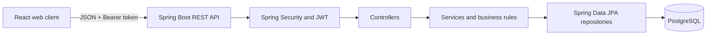

# CodeReview API

[](https://github.com/YgorAdaltoFonseca/CodeReview-Api/actions/workflows/ci.yml)


A full-stack code review request manager. Developers submit changes for review, reviewers claim requests and provide feedback, and administrators manage account roles.

## Features

- Registration and JWT-based authentication with BCrypt password hashing.
- Role-based access for `DEVELOPER`, `REVIEWER`, and `ADMIN` users.
- Review request creation, filtering, pagination, updates, cancellation, and resubmission.
- Exclusive reviewer assignment with database locking to prevent competing claims.
- Reviewer comments, decisions, and transactional status history.
- User and resource ownership checks enforced by the API.
- React and TypeScript web interface for developers, reviewers, and administrators.
- OpenAPI documentation and Swagger UI.
- Docker Compose setup for the API, web client, PostgreSQL, and pgAdmin.

## Technology

| Area | Technology |
| --- | --- |
| Backend | Java 21, Spring Boot, Spring Security, Spring Data JPA |
| Authentication | JWT Bearer tokens, BCrypt |
| Database | PostgreSQL 17 |
| Frontend | React, TypeScript, Vite, React Router |
| Build and delivery | Maven, pnpm, Docker Compose, GitHub Actions |

## Architecture

The backend uses a layered structure: controllers handle HTTP, services enforce business rules, repositories access the database, and DTOs define the API contract.



Each request has one assigned reviewer at most. A developer cannot review their own request. Status changes and their history entries are saved in the same transaction.

```text
OPEN -> IN_REVIEW -> APPROVED
                   -> CHANGES_REQUESTED -> IN_REVIEW
                   -> REJECTED
OPEN or CHANGES_REQUESTED -> CANCELLED
```

`APPROVED`, `REJECTED`, and `CANCELLED` are final states.

## Run with Docker Compose

Requirements: Docker Desktop or Docker Engine with the Compose plugin.

1. Create a local environment file:

   ```bash
   cp .env.example .env
   ```

   In PowerShell, use `Copy-Item .env.example .env`.

2. Replace the database and pgAdmin password placeholders in `.env`. The checked-in JWT key is only for disposable local development; use a separate Base64 secret that decodes to at least 32 bytes for other environments. Never commit `.env`.

3. Start the application:

   ```bash
   docker compose up --build
   ```

The services are available at:

| Service | URL |
| --- | --- |
| Web client | [http://localhost:3000](http://localhost:3000) |
| REST API | [http://localhost:8080](http://localhost:8080) |
| Swagger UI | [http://localhost:8080/swagger-ui/index.html](http://localhost:8080/swagger-ui/index.html) |
| OpenAPI JSON | [http://localhost:8080/v3/api-docs](http://localhost:8080/v3/api-docs) |
| pgAdmin | [http://localhost:5050](http://localhost:5050) |

### Create the first administrator

Public registration always creates a `DEVELOPER`. To create the first administrator in a fresh database, set `APP_BOOTSTRAP_ADMIN_ENABLED=true` and provide the administrator name, email, and password in `.env` before starting Compose. The bootstrap only creates an administrator when none exists. After startup, turn the setting off and remove the bootstrap password from `.env`.

Stop the services while preserving database data with `docker compose down`. `docker compose down -v` also deletes the PostgreSQL volume and all local database data.

## API overview

Protected endpoints require:

```http
Authorization: Bearer <token>
```

| Method | Endpoint | Access |
| --- | --- | --- |
| `POST` | `/api/auth/register` | Public; creates a developer account |
| `POST` | `/api/auth/login` | Public; returns a JWT |
| `POST` | `/api/reviews` | Developer |
| `GET` | `/api/reviews` | Authenticated; scoped by role and ownership, paginated and filterable |
| `GET` | `/api/reviews/{id}` | Authorized request participants |
| `PATCH` | `/api/reviews/{id}` | Request owner while status is `OPEN` |
| `PATCH` | `/api/reviews/{id}/cancel` | Request owner while cancellation is allowed |
| `PATCH` | `/api/reviews/{id}/resubmit` | Request owner after requested changes |
| `PATCH` | `/api/reviews/{id}/claim` | Reviewer; claims an available request |
| `POST` | `/api/reviews/{id}/comments` | Assigned reviewer |
| `POST` | `/api/reviews/{id}/decision` | Assigned reviewer |
| `GET` | `/api/reviews/{id}/history` | Authorized request participants |
| `GET` | `/api/admin/users` | Admin; paginated user list |
| `PATCH` | `/api/admin/users/{userId}/role` | Admin |

Review lists accept `page`, `size`, `status`, and `sort`, for example:

```http
GET /api/reviews?page=0&size=10&status=OPEN&sort=createdAt,desc
```

### Example: register, log in, and create a request

```bash
curl -X POST http://localhost:8080/api/auth/register \
  -H 'Content-Type: application/json' \
  -d '{"name":"Alex Developer","email":"alex@example.com","password":"SafePassword123!"}'

TOKEN=$(curl -s -X POST http://localhost:8080/api/auth/login \
  -H 'Content-Type: application/json' \
  -d '{"email":"alex@example.com","password":"SafePassword123!"}' | jq -r '.token')

curl -X POST http://localhost:8080/api/reviews \
  -H "Authorization: Bearer $TOKEN" \
  -H 'Content-Type: application/json' \
  -d '{"title":"Review login flow","description":"Please review token validation.","repositoryUrl":"https://github.com/example/app","pullRequestUrl":"https://github.com/example/app/pull/12"}'
```

The request author, initial `OPEN` status, and timestamps are set by the API. Repository and pull request links are stored as HTTPS URLs; the application does not connect to GitHub.

## Authentication and browser storage

The web client keeps the JWT in memory and clears it on reload or sign-out, so a page reload requires a new login. It does not persist the token in `localStorage`. The frontend uses token claims to display relevant navigation; the backend remains responsible for enforcing every role and ownership rule.

## Run locally without Docker for the application

Start only PostgreSQL with Compose, then run the backend using Java 21 and Maven:

```bash
docker compose up -d postgres
./mvnw spring-boot:run
```

On Windows, use `.\mvnw.cmd spring-boot:run` in PowerShell. The application requires `DB_PASSWORD` and `JWT_SECRET`; `.env` is not loaded automatically by Maven. In PowerShell, load its values and map the database settings before running:

```powershell
Get-Content .env | Where-Object { $_ -match '^\s*[^#].*=' } | ForEach-Object {
    $name, $value = $_ -split '=', 2
    [Environment]::SetEnvironmentVariable($name.Trim(), $value.Trim(), 'Process')
}
$env:DB_URL = "jdbc:postgresql://localhost:5432/$env:POSTGRES_DB"
$env:DB_USERNAME = $env:POSTGRES_USER
$env:DB_PASSWORD = $env:POSTGRES_PASSWORD
```

In Bash, load and map the same settings with:

```bash
set -a
source .env
set +a
export DB_URL="jdbc:postgresql://localhost:5432/$POSTGRES_DB"
export DB_USERNAME="$POSTGRES_USER"
export DB_PASSWORD="$POSTGRES_PASSWORD"
```

`DB_URL` defaults to `jdbc:postgresql://localhost:5432/codereview`.

To run the web client separately, install Node.js 22.12 or newer and pnpm 11, then:

```bash
cd frontend
pnpm install --frozen-lockfile
pnpm dev
```

Vite serves the client at [http://localhost:5173](http://localhost:5173) and proxies API calls to port `8080`.

## Tests and CI

The backend tests use PostgreSQL. Start the database, configure the database environment variables, and run:

```bash
./mvnw clean verify
```

Build and lint the frontend with:

```bash
cd frontend
pnpm install --frozen-lockfile
pnpm build
pnpm lint
```

GitHub Actions runs backend tests against PostgreSQL, builds the frontend and both Docker images, and validates the k6 load-test script.

## Performance scenario

`performance/reviews-load.js` exercises the paginated review list with 10 virtual users for 60 seconds. Its initial target is p95 below 500 ms and a failed-request rate below 1%.

Run it only against a non-production environment with a dedicated test account and representative data. The script does not create or remove records. Record the API/database environment, account role, visible request count, and k6 results with each measurement.

#### Recorded benchmark (2026-10-28)

- **Application commit:** `d00eb4f` (the merge commit for PR #2).
- **Environment:** local Windows host with Docker Desktop; API built from the tested commit with Java 21 and PostgreSQL 17 in containers. The benchmark used a fresh, isolated database; container CPU and memory limits were not pinned.
- **Dataset:** 1,000 synthetic `OPEN` review requests owned by one `DEVELOPER` test account. The query returned pages of 10 requests.
- **Load:** 10 virtual users for 60 seconds; 113,045 HTTP requests; 0 failed requests; all 226,088 response checks passed.
- **Latency:** p50 4.32 ms, p90 6.45 ms, p95 8.27 ms, maximum 128.78 ms.
- **Result:** passed the initial targets of p95 below 500 ms and failed-request rate below 1% in this local test environment.

This measurement uses synthetic data and a single developer workstation. It does not predict production latency or replace a benchmark on the intended deployment hardware and workload.

With k6 installed, set `K6_BASE_URL`, `K6_EMAIL`, and `K6_PASSWORD` in the shell and run:

```bash
k6 run performance/reviews-load.js
```

The same test can run in Docker without installing k6 locally. Set `K6_EMAIL` and `K6_PASSWORD` in the PowerShell session, then run:

```powershell
$env:K6_BASE_URL = 'http://host.docker.internal:8080'
Get-Content -Raw .\performance\reviews-load.js | docker run --rm -i --env K6_BASE_URL --env K6_EMAIL --env K6_PASSWORD grafana/k6@sha256:3e4186aea62e11a45560bfc51e19eeafe82fc07ce069c78aff44b7ff893d9a5e run -
```

See the [official k6 Docker instructions](https://grafana.com/docs/k6/latest/get-started/running-k6/).

## Environment variables

| Variable | Purpose |
| --- | --- |
| `POSTGRES_DB` | Database name |
| `POSTGRES_USER` | Database username |
| `POSTGRES_PASSWORD` | Database password |
| `DB_URL` | JDBC URL when running the API outside Compose |
| `DB_USERNAME` / `DB_PASSWORD` | API database credentials |
| `JWT_SECRET` | Base64 HMAC key; at least 32 decoded bytes |
| `APP_BOOTSTRAP_ADMIN_ENABLED` | Create the first administrator when enabled |
| `APP_BOOTSTRAP_ADMIN_NAME` | Initial administrator name |
| `APP_BOOTSTRAP_ADMIN_EMAIL` | Initial administrator email |
| `APP_BOOTSTRAP_ADMIN_PASSWORD` | Initial administrator password; stored with BCrypt |

The `.env.example` values are for local development only. Do not use them in a public deployment.
